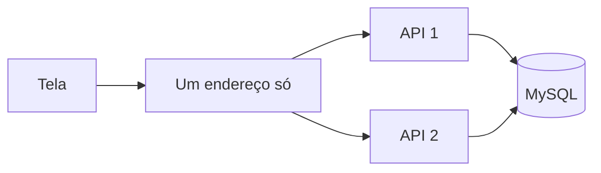

# Hero Factory: desafio fullstack pleno

**Construa um sistema de heróis e missões que continue certo com muita gente usando ao mesmo tempo.**

Obrigado pelo interesse em trabalhar com a gente. Leia tudo antes de começar.

## Regras da entrega

- Prazo: **3 dias corridos** a partir do recebimento.
- Repositório público no seu GitHub, sem citar o nome da empresa.
- Pode usar IA.
- Dúvida? Pergunte ao recrutador por e-mail.
- Para entregar, responda o e-mail com seu nome e o link do repositório.

## Tecnologia

| Parte | Regra |
|---|---|
| Tela | React com TypeScript. Framework e componentes livres. |
| API | Node.js com TypeScript. ORM ou SQL, você escolhe. |
| Banco | MySQL 8 ou mais novo, em Docker. |
| Subir tudo | Um comando, num clone novo do repositório. |

A API roda em **duas instâncias ao mesmo tempo**.

- As duas usam o mesmo banco.
- A tela conhece um endereço só.
- Nesse endereço, algo recebe os pedidos e divide entre as duas instâncias.
- Qualquer pedido pode cair em qualquer instância.



## Heróis

### O herói

```json
{
  "id": "e314636e-1ca6-4925-a0e7-da5eb5ae2403",
  "name": "Robert Bruce Banner",
  "nickname": "Hulk",
  "date_of_birth": "1962-04-10",
  "universe": "Marvel",
  "main_power": "Força",
  "avatar_url": "https://exemplo.com/hulk.jpg",
  "is_active": true,
  "created_at": "2024-09-18T21:41:43.120Z",
  "updated_at": "2024-09-18T21:41:43.120Z"
}
```

| Campo | Regra |
|---|---|
| `name`, `nickname`, `universe`, `main_power` | Obrigatórios. Texto só com espaços conta como vazio. Defina e documente o tamanho máximo. |
| `date_of_birth` | Obrigatório. É um dia, sem hora: quem escolhe 10/04/1962 vê 10/04/1962 em qualquer fuso. Não pode ser no futuro. |
| `avatar_url` | Opcional. Se não tiver avatar, ou se a imagem não carregar, a tela mostra uma imagem padrão. |
| `id`, `created_at`, `updated_at` | Só o servidor define. Mandar esses campos no pedido não pode mudá-los. |

Você pode acrescentar campos ao herói se a sua solução precisar.

Diferencial, não obrigatório: enviar a imagem do avatar do computador, em vez de colar um link.

### A tela de heróis

- A tela inicial é a lista de heróis, com busca, botão de criar e paginação.
- Clicar num herói abre um modal com os dados dele e o histórico.
- Criar e editar acontecem num modal.
- Cada card tem um menu de ações. Os botões mudam com a situação do herói:

| Situação | Ações no menu |
|---|---|
| Ativo | Editar, Inativar, Excluir |
| Inativo | Ativar, Excluir. O card fica cinza. |

- Inativar, ativar e excluir pedem confirmação antes de acontecer.
- Depois de qualquer ação, a lista se atualiza sem recarregar a página.

### Regras

| Regra | Detalhe |
|---|---|
| Inativo | Continua na lista. Não pode ser escalado em missão. |
| Excluído | Some da lista e da busca, e não volta. As missões de que ele participou continuam mostrando o nome dele. |
| Lista | Mais novos primeiro, 10 por página, 5 por linha no computador. |
| Busca | Por nome ou nome de guerra, em qualquer parte do texto, sem diferenciar maiúsculas e acentos. Ex.: `joao` encontra "João". |
| Paginação | Cursor ou limit e offset, você escolhe. Com vários heróis criados no mesmo segundo, nenhum se repete nem some entre as páginas. |
| Volume | Um seed cria **100 mil heróis**. Rodar o seed de novo não duplica nada. |
| Velocidade | Com esse volume, a primeira página e uma busca respondem em menos de **0,3 segundo**. Mostre como mediu. |

### Criar duas vezes

Clicar duas vezes em Salvar cria um herói só.

O mesmo vale neste caso:

1. A pessoa clica em Salvar.
2. A API cria o herói.
3. A internet cai, e a resposta não chega à tela.
4. A pessoa clica em Salvar de novo.
5. Continua existindo um herói só.

### Editar ao mesmo tempo

1. A Ana e o Bruno abrem a edição do Hulk ao mesmo tempo.
2. A Ana muda o nome de guerra para "Hulk Verde" e salva.
3. O Bruno muda o universo e salva.
4. O Bruno recebe um erro: o Hulk mudou depois que ele abriu a tela.
5. O Bruno atualiza os dados sem perder o que digitou, e a mudança da Ana não se perde.

Como juntar as duas edições é decisão sua.

### Histórico

- O modal do herói mostra cada mudança: quando foi, o valor antigo e o valor novo.
- Ex.: "28/10, 14h05: nome de guerra mudou de Hulk para Hulk Verde".
- Mostra também as missões de que ele participou e como cada uma terminou.
- O histórico pode ficar grande. Pagine e ofereça os filtros que achar úteis.

### Exemplo de rotas

As outras rotas são com você.

| Rota | Faz |
|---|---|
| `GET /heroes` | Lista e busca |
| `GET /heroes/:id` | Mostra um herói |
| `POST /heroes` | Cria |
| `PATCH /heroes/:id` | Edita |

## Missões

### A missão

```json
{
  "id": "4b1f0c2a-7d6e-4c55-9a51-0c1e2f3a4b5c",
  "title": "Proteger a ponte",
  "starts_at": "2026-11-03T13:00:00.000Z",
  "ends_at": "2026-11-03T15:00:00.000Z",
  "status": "scheduled",
  "heroes": [
    { "id": "e314636e-1ca6-4925-a0e7-da5eb5ae2403", "nickname": "Hulk" }
  ]
}
```

| Situação | Quando |
|---|---|
| Agendada | Criada, ainda não começou. Só aqui dá para escalar e tirar heróis. |
| Em andamento | Alguém iniciou a missão. Precisa ter pelo menos 1 herói. |
| Sucesso ou fracasso | Alguém encerrou a missão em andamento com esse resultado. |
| Cancelada | Alguém cancelou antes de encerrar. |

### A tela de missões

- Lista de missões, com filtro por situação.
- Modal de criação, com título, começo e fim.
- Modal de detalhes, onde a pessoa escala heróis, tira heróis e muda a situação.
- A tela mostra os horários no fuso de quem usa.

### Choque de horário

Um herói não pode estar em duas missões com horários que batem. Missão encerrada ou cancelada não conta.

Imagine o Thor escalado na Missão A, das 10h às 12h:

```mermaid
gantt
    dateFormat HH:mm
    axisFormat %H:%M
    section Thor
    Missão A escalado      :a, 10:00, 12:00
    Missão B recusada      :crit, b, 11:00, 13:00
    Missão C aceita        :c, 12:00, 14:00
```



A Missão C é aceita porque terminar às 12h e começar às 12h não é choque.

### Escalação ao mesmo tempo

1. As Missões A e B têm horários que batem.
2. A Ana escala o Thor na Missão A.
3. No mesmo instante, o Bruno escala o Thor na Missão B.
4. Cada pedido cai numa instância diferente da API.
5. **Só um dos dois consegue.** O outro recebe um erro que explica o choque.

## Importação de CSV: opcional

Diferencial, não obrigatório.

A tela tem um botão "Importar CSV". O arquivo tem até **20 mil heróis**, e a primeira linha é sempre esta:

```
name,nickname,date_of_birth,universe,main_power,avatar_url
```

- A importação roda em segundo plano. A API continua respondendo durante ela.
- A tela mostra o andamento. Ex.: "8.000 de 20.000".
- No fim, a tela mostra um resumo e o motivo de cada linha recusada. Ex.: "19.950 importados, 30 já existiam, 20 com erro. Linha 18: data no futuro."
- Uma linha errada não impede as outras de entrarem.
- Enviar o mesmo arquivo de novo não duplica heróis. Defina e documente quando um herói conta como repetido.
- Outra importação pode começar enquanto uma ainda roda.

## Erros e telas

- Defina um formato único de erro para a API inteira.
- O status HTTP combina com o erro. Ex.: herói que não existe não responde 400. Entrada inválida não responde 500.
- A mensagem é clara para quem usa a tela e diz qual campo está errado quando for o caso.
- Siga o visual das telas de referência abaixo: layout, cores, componentes e espaçamentos.
- As telas que não estão nas referências, como missões, importação e histórico, seguem esse mesmo padrão.
- A tela sempre mostra quando está esperando, quando deu certo, quando deu erro e quando a lista está vazia.
- Ex.: com a API fora do ar, a tela avisa e oferece tentar de novo. Ela não pode parecer uma busca sem resultado.
- A tela funciona do celular de 320 pixels ao monitor de 1920, inclusive com nomes longos.


## Testes

Escreva testes que protejam as regras deste documento.

## Fora do escopo

- Login e permissões.
- Publicar na internet.

## Como avaliamos

1. Seguimos o seu README ao pé da letra.
2. Usamos a tela como uma pessoa usaria.
3. Chamamos a API direto, sem a tela, para tentar burlar as regras.
4. Lemos o código.
5. Conversamos com você sobre a entrega.

